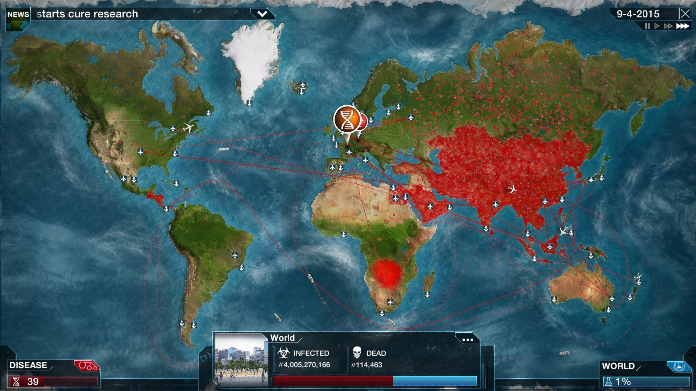
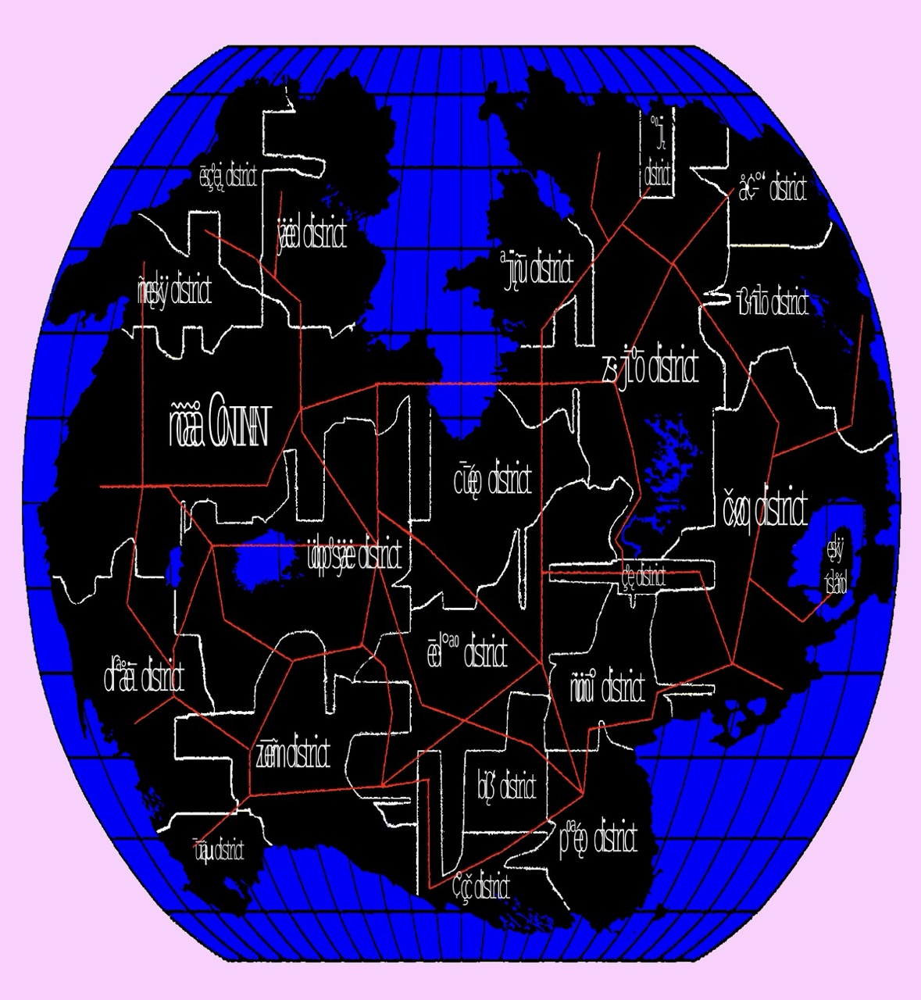
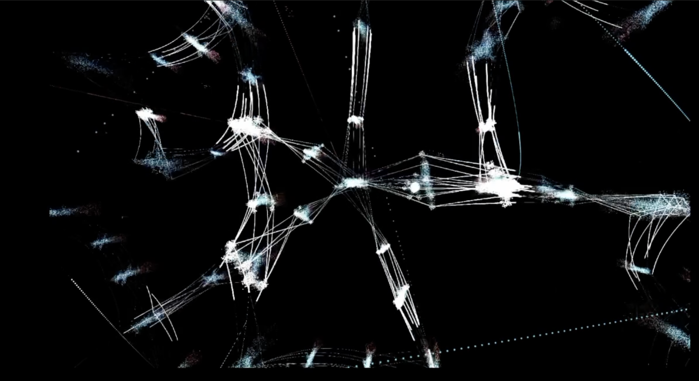

# 𖨠 26.10.19 - Project Definition 𖨠   (w/ Douglas Edric Stanley) 

 

Today, we need to clarify certain points and describe some concepts.

What is: 

- Playable Micro-Experiences
- Collective Library (online platform)

→ We will create one web page per project — all of which will be gathered in a shared library.

## Game ideas - Web Jumping

List of words :

- Network (Réseau) → social / group of person 
- Relation / connection 
- Investigation
- link
- Web

→ Most of the words above carry a different meaning depending on the context in which they are used (digital / IRL).

### You are presented with a "network" of individuals; your objective is to identify the interpersonal "connections" based on each person's online data.

→ The game asks you to identify the different "roles" (harasser, victim, bystander, etc.)

→ You must uncover the various connections between the individuals.

→ Navigation takes place through a "network". Each node represents a person and/or their data (messages, photos, contacts, social media, etc.).

You play a kind of program that moves around the "web," jumping from one profile to another.

### Inspirations

  
[<i>The Roottrees are Dead</i>](https://store.steampowered.com/app/2754380/The_Roottrees_are_Dead/)

  
<i>Plague Inc.</i> 

  
<i>Mona Jakon ARG - Map / personal archive</i>

  
[<i>A Hand With Many Fingers</i>](https://colestia.itch.io/a-hand-with-many-fingers)

  
<i>Touchdesigner Patch / personal archive</i>

  
<i>representation of neurons found on the web (IDK...)</i>

## Game ideas [Raimundo]

## REF:

- [Robin Baumgarten](https://www.wobblylabs.com/)
- [Kikk festival](https://kikk.be/)
- [Atlas of Anomalous AI](https://curamagazine.com/digital/atlas-of-anomalous-ai/)
- [JODI](https://net-art.org/jodi)
- [reverse-engineer-anything](https://github.com/topics/reverse-engineer-anything)
-
