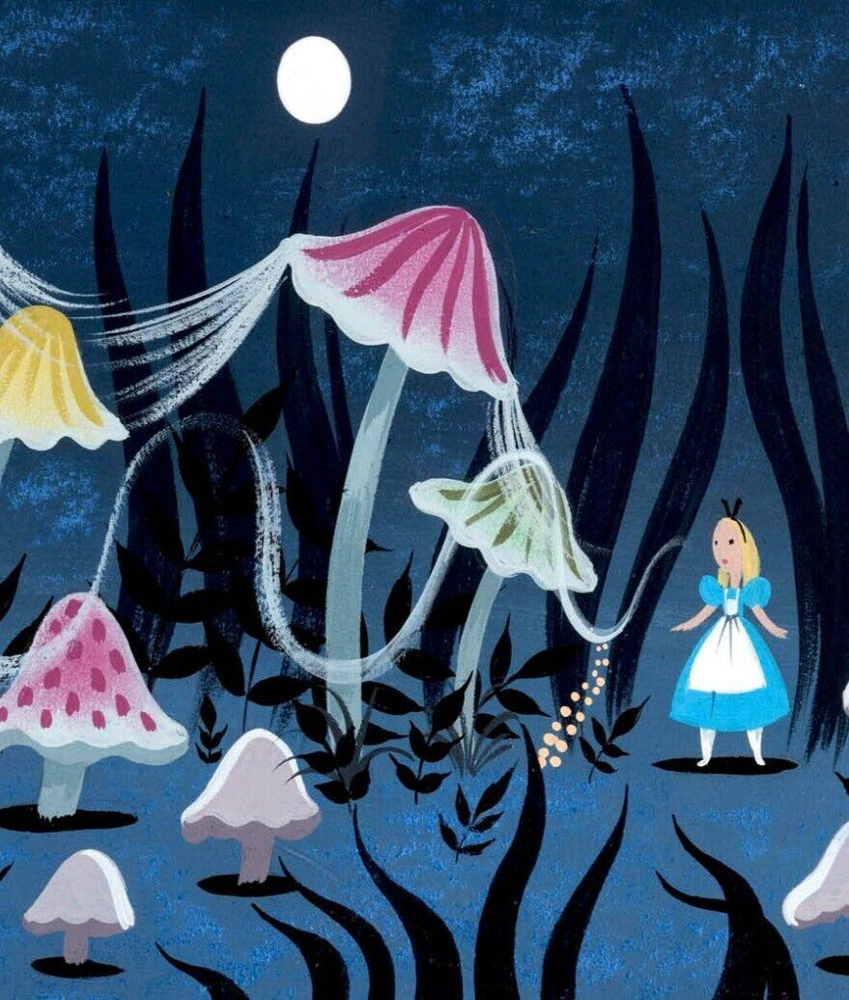
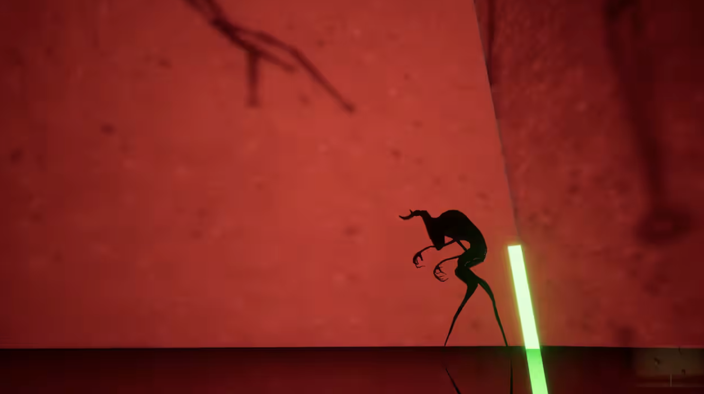
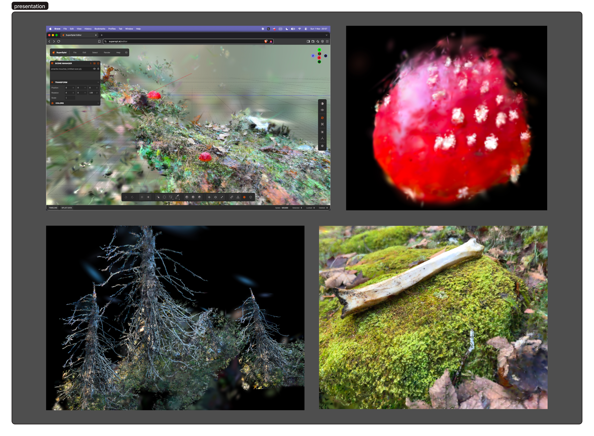
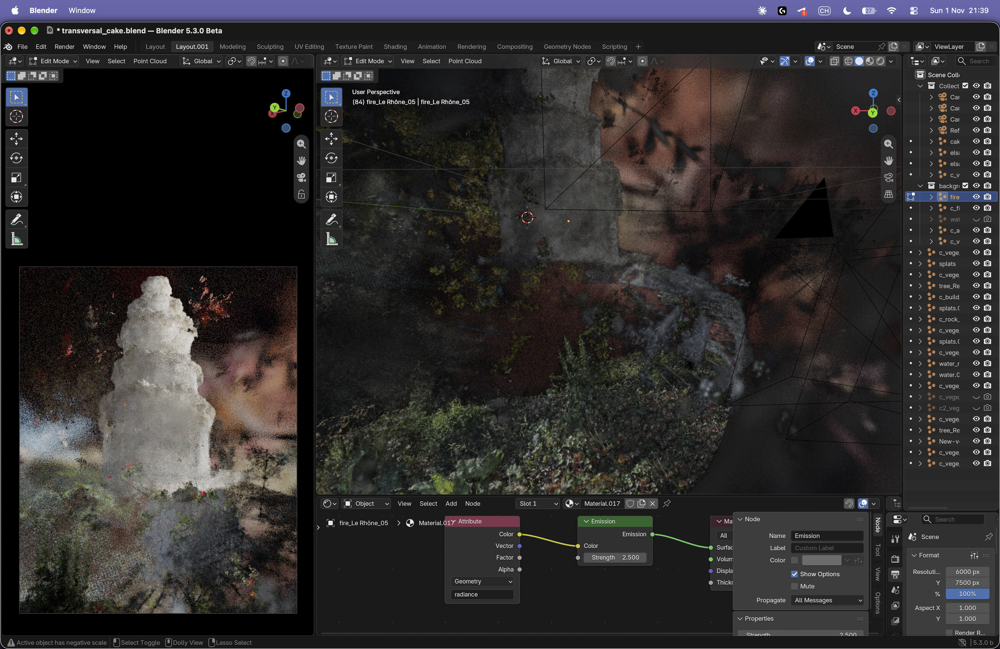
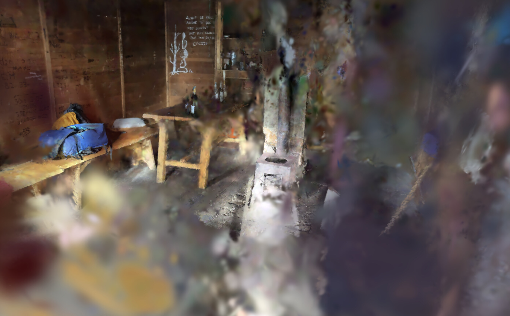

# Sweet [Digital] Dreams [26-11-02]

**Pitch**

The game explores how social pressure shapes a bystander's choices and how their participation can amplify cyberbullying.
It unfolds as a linear interactive narrative structured around a day-and-night cycle.

## The Game
#### Starting Point
- The game starts from the idea that bystanders influence a situation of cyberbullying, whether they intervene, participate, or remain passive.
#### Mechanics
- Although the player appears to have a choice, attempts to help initially trigger an error. These options then disappear, leaving participation in the bullying as the only way to progress.
- The nighttime dream sequences reflect the character's inner state, shaped by what they have done and witnessed during the day.
#### Narrative
- The game alternates between situations of harassment within digital spaces and moments of introspection unfolding in dreamlike environments.
- The “Night” or “Dream” phase reflects the psyche of the character the player embodies, shaped by their actions and decisions throughout the day.

#### Conclusion

In a situation of cyberharassment, what role does a bystander assume? Are they expected to intervene? And if they choose not to, can their position truly be considered neutral?

Having most likely already witnessed situations of harassment, players are invited to reflect on the actions they could take, or choose not to take, when confronted with such situations. 

## Moodboard 

## Influences 
- [conectado](https://e-ucm.github.io/ConectadoWeb/)
- [Mélanie Courtinat](https://melaniecourtinat.com/PERSONAL)
- [Alice Madness Return](https://store.steampowered.com/app/19680/Alice_Madness_Returns/)
- [Return of the Obra Dinn](https://store.steampowered.com/app/653530/Return_of_the_Obra_Dinn/)
- [kidamensia exhibition game](https://store.epicgames.com/p/kid-a-mnesia-exhibition)
- [Manifold Garden](https://manifold.garden/)

## Feedbacks [w/ Basile Perret]

#### Remarks

- Beware of the "bystander" cliché! [this is already a common perspective]
- What type of harassment are we talking about??? [important to define this as early as possible]
- For someone experiencing harassment, nighttime is a moment filled with anxiety—introspection is difficult under such conditions.

#### To be defined: 
- What type of [cyber]harassment are we talking about?
- How does the "night" phase take shape?
- Can we consider the entire game to be set within a digital space (even the dream sequences)?
- Digital spaces are often places where we seek to project a specific self-image—we could explore the concept of a "digital facade/identity" that shatters.
- Note: I like the idea of ​​treating digital spaces as physical ones. This raises the question: what forms of harassment are specific to digital spaces, and how can they be translated from physical environments?
- If we opt for a short, linear narrative, could we envision the game as a kind of "narrative walk"? (e.g., [The Stanley Parable](https://store.steampowered.com/app/221910/The_Stanley_Parable/) or [Eclipsium*](https://store.steampowered.com/app/2419670/Eclipsium/))
- Games aren't just about rules—they’re about interacting with rules!

It is important to keep in mind that some form of action is always necessary.

Loneliness is a significant factor when one is a victim.

**One must identify a form of harassment — and understand the dynamics involved.**

<u>**Do not approach these games as educational games.**</u>

Analyze a situation involving harassment to distill it into a simple form of interaction. --> Understand its context (setting/time).

What is the dilemma / the engaging element / the unique aspect?

--> What is a dilemma ? You have 2 options and the 2 of them are bad.

Example: If I take a real-life situation (a personal one, for instance) and change one element, what happens? What kind of alternative reality is created?

# Pitch preparation for 26-11-09 

- **Setup**: A TikTok account posts videos that mock the teachers of a class. Students begin feeding information about their classmates into the account, it spirals out of control and starts producing content that openly mocks everyone in the class.

- **Perspective**: A group of student attempting to seek justice, having been targeted by the account, ends up replicating the very same mechanisms of violence that they themselves were subjected to. The focus shifts from one student (in the group) to another as the story unfolds.

- **The Compelling Aspect**: **How do people interact with the account ?**
 **The account is a personification of the algorithm.**

The group wants to understand how it functions but in doing so, they end up creating forms of harassment without intending to.