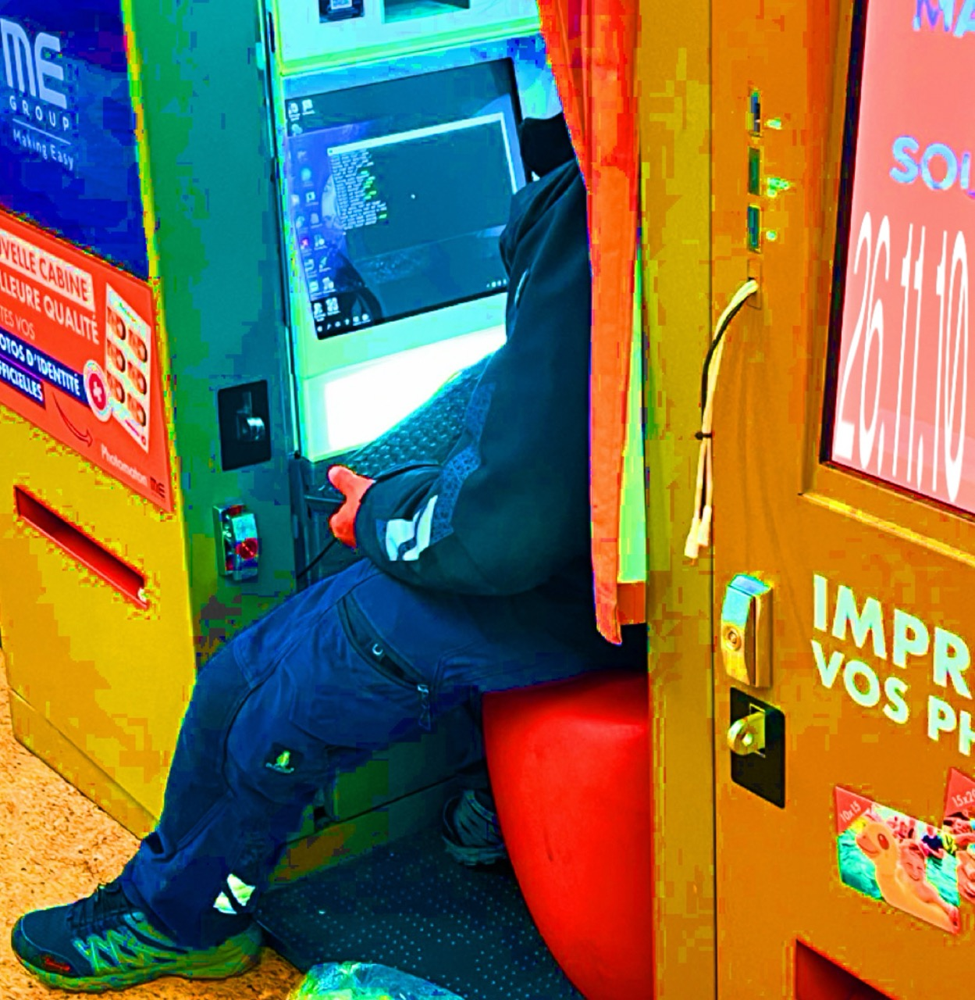

# 𖨠 26-11-10 Project Clarification 𖨠

The feedback we received yesterday does not serve to validate or disqualify the idea - rather, it acts as support to help us **move forward**.

For next week, we are gonna prepare a presentation for Mariana - here is the structure :

# Presentation 

## Title 

## Pitch 

## What is the experience about
- What is the dilemma of the (main) characters ? 
- How does this dilemma relate to cyberbulling ? 

## What is understood / What knowledge is learned ?