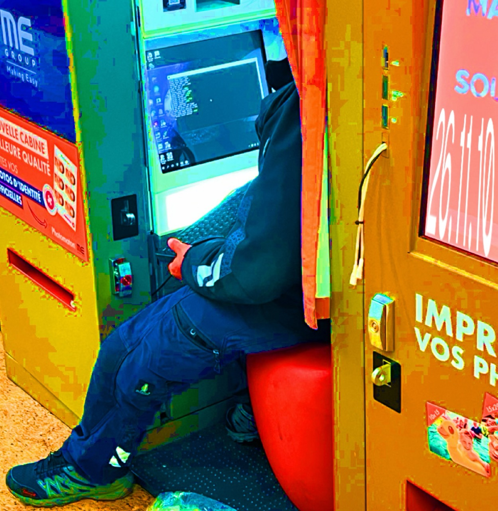

# 𖨠 26-11-10 Project Clarification 𖨠

The feedback we received yesterday does not serve to validate or disqualify the idea - rather, it acts as support to help us **move forward**.

For next week, we are gonna prepare a presentation for Mariana - here is the structure :

# Presentation 

## Tik Tak Tik Tak 

## Pitch 

In a secondary school classroom, an anonymous account begins posting AI-generated content about students in a class. A group of students then decides to investigate this account in order to find its creator and put an end to its activity.

## What is the experience about

Our experience shows how social media algorithms amplify or prolong harassment.

- What is the dilemma of the (main) characters ? 

   - How can collective action be taken to break free from the grip of this account?   (The best tool is to deny the harasser the satisfaction they seek.)

- How does this dilemma relate to cyberbulling ? 

    - Group dynamics can turn every moments into harassment: a sticker can become a weapon... Through peer pressure, conformity, and social reinforcment, a group can normalise cruality until taking part feels easier than speaking out. 

- How does the "cyber" component affect this dilemma ?

    -  Behind a screen, you cannot see people's reactions or faces. Social media can amplify and prolong bullying. Content can be taken out of context without consent.

## What is understood / What knowledge is learned ?
- What tools adolescents can learn from your project ?

- How does the story internally lead to that understanding ? 

## Agency 
- How does this story explore adolescent agency ?

    - The story explores the ability of young people to influence (or be influenced by) a group. The character must decide whether to participate, remain silent, or confront / challenge their friends, at the risk of becoming a target.

## How is your experience played ?
- workshop ?
- group project ?
- Individual ?
    -   Context ?
- Online ?

## Questions for the cool kids 
- What questions do you have for kids that are going to play your experience ?

    - Do you play any games? If so, which one ?
    - Do you play cooperative games? If so, what interests you about them ?
    - 