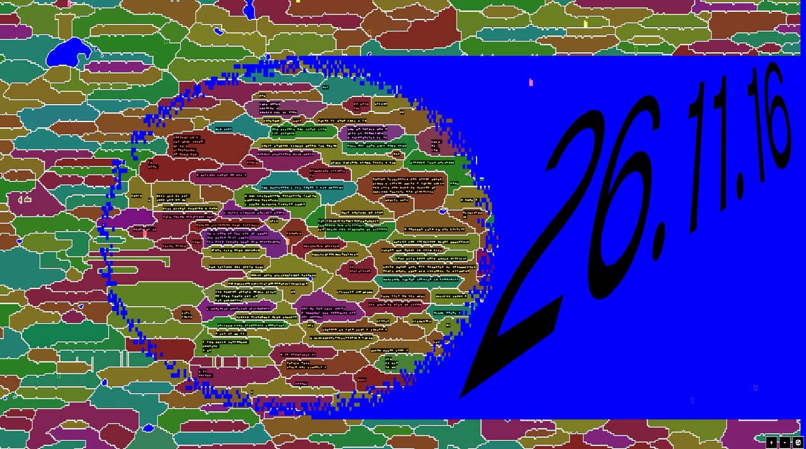

# 𖨠 26-11-16 Project Clarification 𖨠

**What are we trying to achieve with the game — what problem do we wish to address?**

How can these themes/issues be put into practice or explored through a prototype with adolescents?

- How can we ask people questions in a way that encourages them to share their own perspectives?

- How can the same content be received by different types of people?

- Questions for testing: 

    - First and foremost, it is worth establishing the context in which the game is set. [Video games are a context that already carries strong connotations, especially among young people.]
    - How should the test be framed? Position the test without providing guidance.
    - What’s the story? What is it about?
    - What do you think of it? Did you like it?
    - What are your thoughts on the fact that...?
    - Do you find it... (funny, boring, etc.)?
    - Do you know of any similar content?
    - Are there things that bother you? Things you like?
    - Ask questions about the content / place people in the shoes of the game characters → what would you have done in this situation ?
    - For other questions, be specific: what do you think about this particular element? ...
    - Regarding our topic: asking for opinions on crush/meme groups

# Discussion with Mariana 

- The group --> how does this concept function within a situation of harassment?

- Recurring motifs: the idea of ​​a situation that is taken up and repeated—a joke that continues as long as it provokes laughter (what does this reveal about the group/collective?)

- How do behaviors, when reproduced by everyone, become normalized, amplified, or diminished?

- The focus on trivial details (seemingly ridiculous elements) that escalate into something highly violent—this can shed light on the mechanism of seizing upon otherwise innocuous things.

- The group effect --> how does this phenomenon inhibit critical thinking?

- "Cyber" (digital) context --> how are situations subverted or repurposed?

- How can digital media codify a situation of harassment? (e.g., through emoticons, stickers, etc.)

- Perhaps consider a diagram to present—for instance, one illustrating how an element from the game is taken up on social media, involving specific characters—and then connect the gaming experience to real-life personal experience. 

- Online ethnography -> looking at Instagram accounts (crushes / memes / etc.). If used for research, ensure anonymity!!

