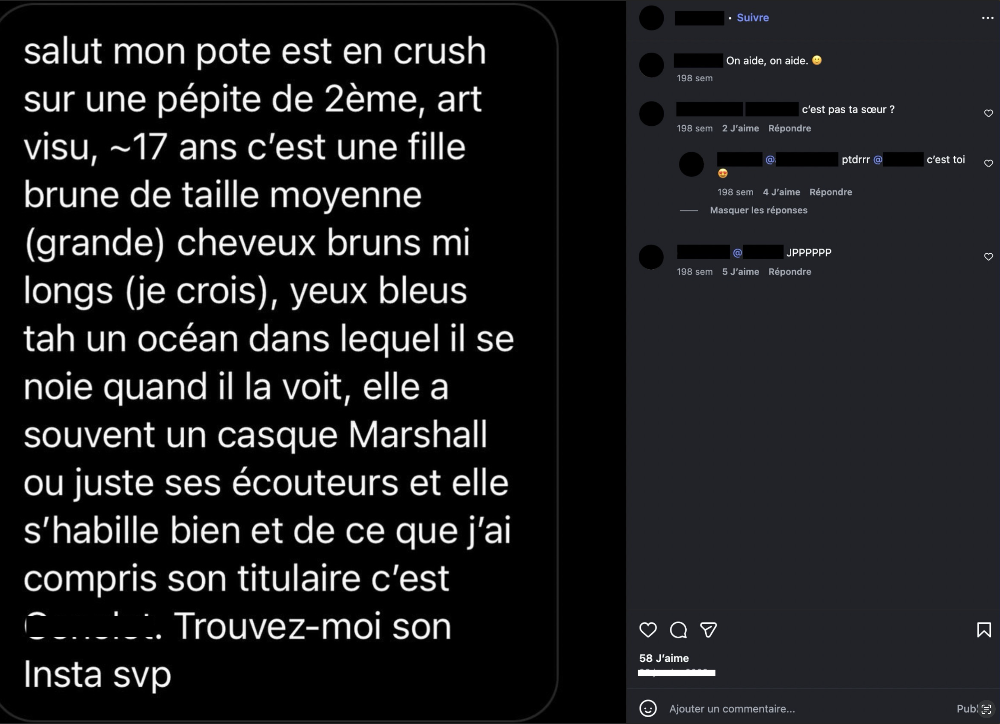
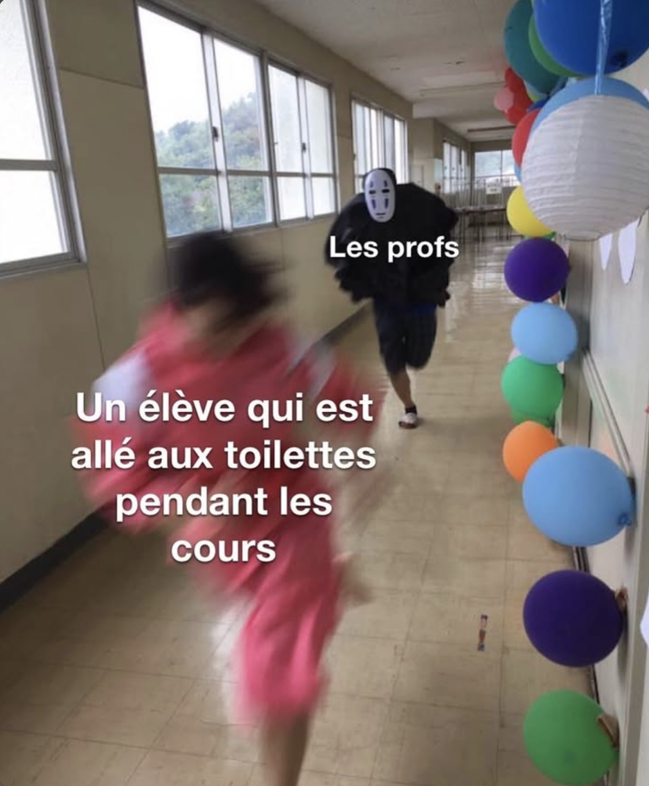
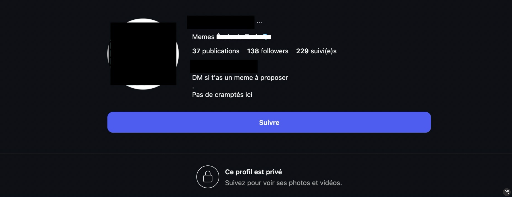
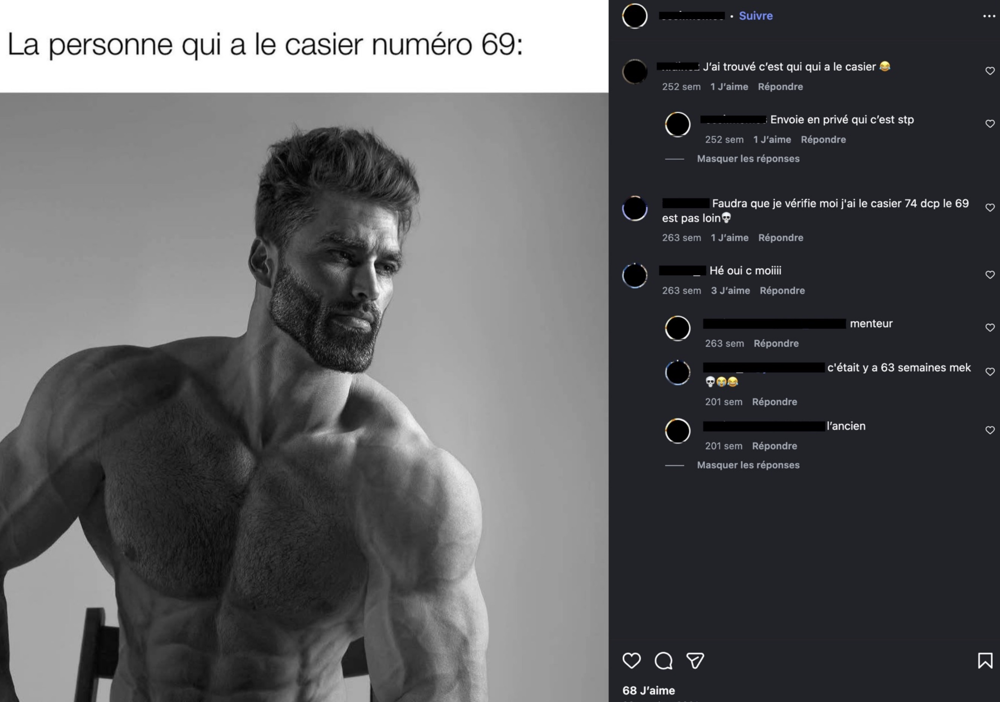

# 𖨠 26-11-16 Project Clarification 𖨠

**What are we trying to achieve with the game — what problem do we wish to address?**

How can these themes/issues be put into practice or explored through a prototype with adolescents?

- How can we ask people questions in a way that encourages them to share their own perspectives?

- How can the same content be received by different types of people?

- Questions for testing: 

    - First and foremost, it is worth establishing the context in which the game is set. [Video games are a context that already carries strong connotations, especially among young people.]
    - How should the test be framed? Position the test without providing guidance.
    - What’s the story? What is it about?
    - What do you think of it? Did you like it?
    - What are your thoughts on the fact that...?
    - Do you find it... (funny, boring, etc.)?
    - Do you know of any similar content?
    - Are there things that bother you? Things you like?
    - Ask questions about the content / place people in the shoes of the game characters → what would you have done in this situation ?
    - For other questions, be specific: what do you think about this particular element? ...
    - Regarding our topic: asking for opinions on crush/meme groups

# Discussion with Mariana / Douglas

- The group --> how does this concept function within a situation of harassment?

- Recurring motifs: the idea of ​​a situation that is taken up and repeated—a joke that continues as long as it provokes laughter (what does this reveal about the group/collective?)

- How do behaviors, when reproduced by everyone, become normalized, amplified, or diminished?

- The focus on trivial details (seemingly ridiculous elements) that escalate into something highly violent—this can shed light on the mechanism of seizing upon otherwise innocuous things.

- The group effect --> how does this phenomenon inhibit critical thinking?

- "Cyber" (digital) context --> how are situations subverted or repurposed?

- How can digital media codify a situation of harassment? (e.g., through emoticons, stickers, etc.)

- Perhaps consider a diagram to present—for instance, one illustrating how an element from the game is taken up on social media, involving specific characters—and then connect the gaming experience to real-life personal experience. 

- Online ethnography -> looking at Instagram accounts (crushes / memes / etc.). If used for research, ensure anonymity!! 

- How can we create our own story — or reclaim these elements—using material found online ?

- Regarding the posts / content found -> compared

# Online ethnography - Recherches

Based on the research conducted this afternoon, we can identify two broad categories of accounts that are closely tied to the social life of secondary schools:

1. **“Crush” accounts:** These are generally used to help identify or reconnect with someone whose identity is unknown.

2. **“Meme” accounts:** These regularly share memes, usually relating to students’ everyday lives and experiences.

## Crush accounts

In the first case, the content is not explicitly intended to mock any particular individual. However, by drawing attention to a person through a generally broad description, it can indirectly lead to their essentialisation, or even their objectification.

→ Could a situation like this develop into a form of harassment? If enough people are able to identify the individual being described (particularly in a relatively small school, for instance) a post of this kind could become a source of ridicule or mockery, potentially exposing that person to unwanted attention and social pressure. 

→ Adolescents are still in the process of forming their identities. By engaging with these broad descriptions, users of such accounts may contribute to imposing a particular label or narrative onto the individuals concerned. 

<u>**This can, in itself, be perceived as a form of social violence, as it reduces a person to an externally constructed image that they may neither identify with nor have control over.**</u>

Furthermore, the individual's social account is explicitly brought into the spotlight (a defining feature of this type of “crush” account). Needless to say, this further contributes to a form of social pressure, making the person more visible and potentially exposing them to unwanted attention from their peers.

## Meme accounts

" An internet meme, or meme, is a cultural item (such as an idea, behavior, or style) that spreads across the internet, now primarily through social media platforms...

... Two fundamental characteristics of internet memes are creative reproduction and intertextuality. Creative reproduction refers to the adaptation and transformation of a meme through <u>imitation or parody</u>, either by reproducing the meme in a new context ("mimicry") or by remixing the original material ("remix"). "

<i>- Wikipedia description of a meme</i>

In the case of “meme” accounts, the process relies on drawing comparisons between events or situations that are commonly experienced within a school community. 

In some cases, however, a meme may directly refer to a particular group of individuals or to a recognisable archetype that can then be projected onto a specific person.

In the course of my research, I was unable to find any meme accounts that explicitly targeted one or more specific individuals. However, it is worth noting that some of these accounts are private. This raises questions about the reasons behind this choice: do the account owners feel uncomfortable sharing content that could potentially mock specific individuals in a public setting? Could making their accounts private be a way of keeping such content within a more restricted social circle, away from public scrutiny?

In the case of public accounts, forms of social pressure and potential harassment can emerge alongside the content itself, particularly within the comments. The underlying mechanisms are more or less the same as those observed with “crush” accounts, but with one key difference: individuals are brought into the spotlight through a direct comparison with the content of the meme. In this way, one or several people may become the focus of attention, potentially exposing them to ridicule, unwanted scrutiny, or social pressure. 

  

