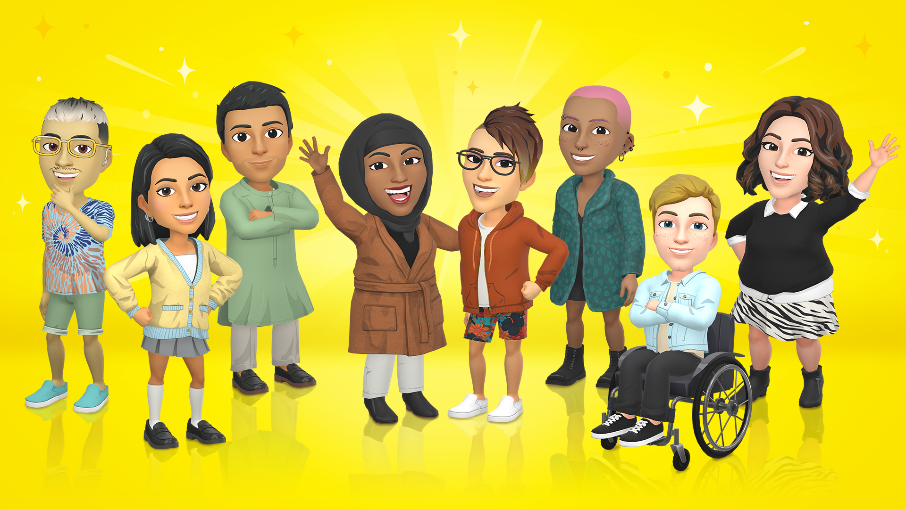

# 𖨠 26-11-17 Talking to Robots 𖨠

Questions:

 - What platforms are available? (appearance, functions, terminology, etc.)

 - Develop a prototype featuring the robot, while applying specific design constraints.

- The narrative needs to be further defined to provide the foundational elements required to create an initial prototype version.

Identify and understand cyber-platform interfaces, and extract elements from them for our prototype.

# Snapchat 

Element retenus par le groupe: 

- custom avatars
    - pour l'immersion → ça permet de se projeter en tant que "protagoniste"/personnage qui fait réellement partie de l'histoire, ce sont nos propres choix lorsqu'on joue
    - strengthens the connection between the user and the experience
    - interface simple, les avatars c'est la seule chose qui rajoute un peu de personnel dans l'app
- le feu
    - la flamme sert à montrer la proximité avec les divers camarades de l'histoire
    - attention : il faut que ceci soit impactant dans le jeu, par ex. la proximité avec Thomas nous donne plus de legitimité pour le remettre en question, mais aussi on a une pression plus grande
- avatars
    - est-ce qu'on veut modifier les avatars d'autres personnes pour montrer leur état émotionnel
- emojis
     - garder les emojis de base
- group chat
     - emojis below, to show who's talking etc
     - montre qui est dans la discussion et qui n'est pas dessus
- stickers
    - les autres personnes peuvent communiquer en sticker, et on peut avoir l'option exceptionnelle parmi les réponses de temps en temps
- GROUP à tester
    - appel vidéo de camille (ou autre personne) pour rythmer l'expérience
    - photos
    - x a pris un screenshot
- USER à enlèver
    - appels
    - vidéos
    - localisation
    - photos
    - clavier

# Avatar

The avatar is one of the most interesting elements on Snap. It conveys the person's mood or vibe.

→ It is important to move away from the aesthetic of Snap avatars: the key is to have avatars that make it possible to identify a person and their feelings.

# Pistes de game design retenues

Idées issues de l'analyse de Snapchat, à explorer pour le prototype.

### 1. La flamme → capital social à double tranchant
- Chaque personnage a une flamme avec les autres membres du groupe.
- Pour l'entretenir, il faut participer, y compris quand les échanges dérapent. Refuser de suivre → la flamme faiblit.
- Rend la **non-action coûteuse et visible** (→ question ouverte n°3).
- Une forte proximité (ex. avec Thomas) donne plus de légitimité pour remettre en question… mais aussi plus de pression.

### 2. Conversations one-to-one éphémères [à creuser]
- Les messages en privé disparaissent après un temps, sauf si quelqu'un fait une capture.
- Le compte serait l'endroit où l'éphémère devient permanent (le rôle d'« estomac »).
- Laisser disparaître = un geste apaisant, simple et lisible.
- Piste : le privé comme espace pour soutenir la personne visée, ou au contraire pour récolter des éléments ?

### 3. Le « Vu » → rendre le silence visible
- La rangée d'avatars en bas du chat montre qui a lu sans répondre.
- « Vu par 3 » est déjà un message : tout le monde sait que tout le monde a vu, mais personne ne réagit.
- Matérialise l'effet spectateur sans le nommer.

### 4. Les avatars → baromètre émotionnel
- L'avatar de la personne visée change peu à peu : posture, expression, puis il disparaît des membres actifs du chat.
- Possible aussi pour les avatars des personnages joués.
- Montre les conséquences sans jamais écrire « tu es harceleur » → évite le jeu éducatif frontal.

### 5. Fin façon « Souvenirs » → récapituler [à creuser]
- Un récapitulatif dans le style Snapchat Memories / « Wrapped ».
- Pour les trois personnages : ce qui a été envoyé, capturé, vu, laissé disparaître.
- Le joueur découvre s'il a aggravé ou apaisé la situation (→ question ouverte n°5).

