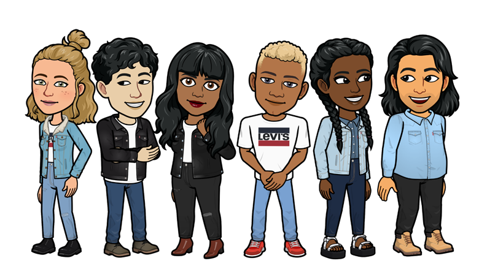
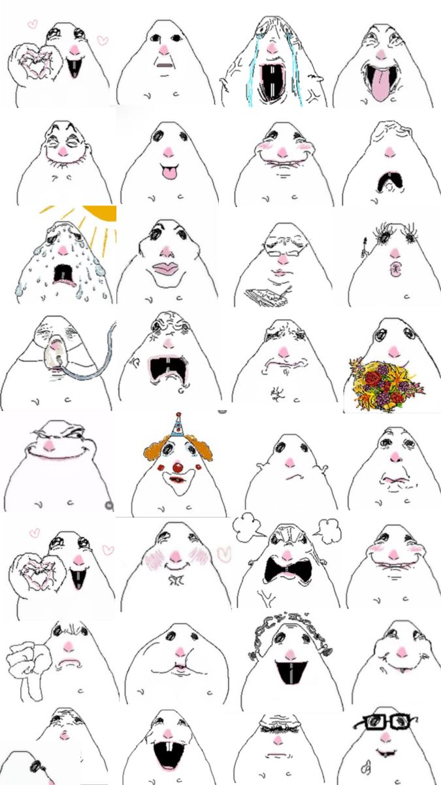

# 𖨠 26-11-17 Talking to Robots 𖨠


Questions:

 - What platforms are available? (appearance, functions, terminology, etc.)

 - Develop a prototype featuring the robot, while applying specific design constraints.

- The narrative needs to be further defined to provide the foundational elements required to create an initial prototype version.


Identify and understand cyber-platform interfaces, and extract elements from them for our prototype.

# Snapchat 

Element retenus par le groupe: 

- custom avatars
    - pour l'immersion → ça permet de se projeter en tant que "protagoniste"/personnage qui fait réellement partie de l'histoire, ce sont nos propres choix lorsqu'on joue
    - strengthens the connection between the user and the experience
    - interface simple, les avatars c'est la seule chose qui rajoute un peu de personnel dans l'app
- le feu
    - la flamme sert à montrer la proximité avec les divers camarades de l'histoire
    - attention : il faut que ceci soit impactant dans le jeu, par ex. la proximité avec Thomas nous donne plus de legitimité pour le remettre en question, mais aussi on a une pression plus grande
- avatars
    - est-ce qu'on veut modifier les avatars d'autres personnes pour montrer leur état émotionnel
- emojis
     - garder les emojis de base
- group chat
     - emojis below, to show who's talking etc
     - montre qui est dans la discussion et qui n'est pas dessus
- stickers
    - les autres personnes peuvent communiquer en sticker, et on peut avoir l'option exceptionnelle parmi les réponses de temps en temps
- GROUP à tester
    - appel vidéo de camille (ou autre personne) pour rythmer l'expérience
    - photos
    - x a pris un screenshot
- USER à enlèver
    - appels
    - vidéos
    - localisation
    - photos
    - clavier

# Avatar

The avatar is one of the most interesting elements on Snap. It conveys the person's mood or vibe.




→ It is important to move away from the aesthetic of Snap avatars: the key is to have avatars that make it possible to identify a person and their feelings.




<hr>

# Pistes de game design retenues

Idées issues de l'analyse de Snapchat, à explorer pour le prototype.

### 1. La flamme → capital social à double tranchant
- Chaque personnage a une flamme avec les autres membres du groupe.
- Pour l'entretenir, il faut participer, y compris quand les échanges dérapent. Refuser de suivre → la flamme faiblit.
- Rend la **non-action coûteuse et visible** (→ question ouverte n°3).
- Une forte proximité (ex. avec Thomas) donne plus de légitimité pour remettre en question… mais aussi plus de pression.

### 2. Conversations one-to-one éphémères [à creuser]
- Les messages en privé disparaissent après un temps, sauf si quelqu'un fait une capture.
- Le compte serait l'endroit où l'éphémère devient permanent (le rôle d'« estomac »).
- Laisser disparaître = un geste apaisant, simple et lisible.
- Piste : le privé comme espace pour soutenir la personne visée, ou au contraire pour récolter des éléments ?

### 3. Le « Vu » → rendre le silence visible
- La rangée d'avatars en bas du chat montre qui a lu sans répondre.
- « Vu par 3 » est déjà un message : tout le monde sait que tout le monde a vu, mais personne ne réagit.
- Matérialise l'effet spectateur sans le nommer.

### 4. Les avatars → baromètre émotionnel
- L'avatar de la personne visée change peu à peu : posture, expression, puis il disparaît des membres actifs du chat.
- Possible aussi pour les avatars des personnages joués.
- Montre les conséquences sans jamais écrire « tu es harceleur » → évite le jeu éducatif frontal.

### 5. Fin façon « Souvenirs » → récapituler [à creuser]
- Un récapitulatif dans le style Snapchat Memories / « Wrapped ».
- Pour les trois personnages : ce qui a été envoyé, capturé, vu, laissé disparaître.
- Le joueur découvre s'il a aggravé ou apaisé la situation (→ question ouverte n°5).


<hr>

# Système de jeu : le témoin et son groupe

Synthèse issue du prototype V1 *Under Your Skin* (testé en narration interactive) et des pistes Snapchat ci-dessus.<br>
Objectif : passer d'éléments d'**interface** à de vraies **mécaniques de gameplay** (un geste, une règle, une tension, un retour).

**Principe :** le joueur gère une ressource rare, son **attention**, entre plusieurs conversations. Pour intervenir, il lui faut des **flammes** (sa légitimité) et des **mots** (son vocabulaire). Son **avatar** montre à tous ce qu'il fait, y compris quand il hésite.

## Les quatre mécaniques

### A. L'attention → on ne peut pas être partout
- Plusieurs conversations arrivent en même temps : le groupe, Thomas, Sarah, Camille. On n'en ouvre qu'une à la fois.
- Les messages privés sont éphémères et expirent s'ils restent sans réponse.
- Toute conversation négligée fait baisser la flamme correspondante.
- → Abandonner Camille n'est jamais un choix explicite : ça arrive parce que tout le reste est plus bruyant.

### B. Les flammes → une monnaie de légitimité
- Chaque relation a une flamme. Participer la nourrit, s'opposer la consomme.
- Tes mots n'ont de poids que si ta flamme avec la personne est assez haute. Un « arrête » envoyé à quelqu'un avec qui ta flamme est faible est ignoré.
- → Pour pouvoir confronter Thomas, il faut avoir été proche de lui, donc en partie complice.

### C. Le vocabulaire → on parle comme son groupe
- Pas de clavier. On compose avec des fragments : mots, stickers, emojis.
- Au départ, l'inventaire ne contient que le langage du groupe : les blagues, le surnom, le sticker du meme.
- Les mots pour soutenir ou recadrer se débloquent dans les échanges privés (Sarah, Camille). Or ces échanges coûtent de l'attention (A).
- → Pour dire autre chose, il faut d'abord sortir de son groupe.

### D. L'hésitation → « en train d'écrire… »
- Composer un message demande de maintenir le doigt appuyé. Pendant ce temps, tout le monde voit que tu écris.
- Le groupe réagit à ton hésitation. Si tu lâches, rien n'est envoyé, mais l'hésitation a été vue.
- La fenêtre se referme : quand le moment est passé, l'intervention ne sert plus à rien.
- → Le joueur vit l'hésitation au lieu de seulement la choisir.

## L'avatar, trois fonctions de jeu

### 1. Lire → la seule façon de percevoir les autres
- Personne ne dit « je vais mal ». L'état émotionnel ne passe que par l'avatar : posture, expression, absence.
- Pour le voir, il faut ouvrir le profil ou la conversation, ce qui **coûte de l'attention** (A).
- L'avatar de Camille change au fil de l'histoire : souriant, puis capuche, puis il disparaît de la rangée des membres du groupe.
- → Ne pas regarder, c'est déjà rater quelque chose.

### 2. Être vu → ton avatar te trahit
- Ton avatar apparaît dans la rangée des présents en bas du chat. Tout le monde sait que tu as lu (« Vu »).
- Pendant que tu composes (D), il prend une pose « en train d'écrire » visible par tous. L'hésitation devient publique.
- Selon ce que tu fais, il **adopte les codes du groupe** (le sticker du meme, une tenue commune) ou s'en éloigne.
- → L'identité sociale du joueur se voit : appartenir au groupe se lit sur son corps virtuel.

### 3. S'exprimer → les poses font partie du vocabulaire
- Les réactions passent aussi par les poses de l'avatar : rire, haussement d'épaules, détourner le regard, bras croisés.
- Elles se débloquent comme les mots (C). Au départ, tu ne sais que rire avec le groupe.
- → Le corps et le langage forment un seul inventaire, façonné par le groupe.

## Comment tout s'imbrique

```
ATTENTION ──── coûte ───► lire les avatars, parler en privé
   │                              │
   │                              ▼
   │                     débloque MOTS + POSES
   ▼                              │
FLAMMES ◄── participer nourrit    │
   │        s'opposer consomme    │
   ▼                              ▼
LÉGITIMITÉ ───────► HÉSITATION (intervenir en public)
                         │
                         ▼
               AVATAR visible par tous
```

## Exemple : l'acte 4, la compilation de Thomas
1. Thomas envoie la compilation dans le groupe. Les avatars rient, 🔥 212 avec lui.
2. En même temps, un message éphémère de Camille clignote (A). L'ouvrir révèle son avatar, capuche baissée (1). Ne pas l'ouvrir le laisse expirer.
3. Tu veux répondre à Thomas. Ton inventaire contient 😂, 💀, le sticker du meme… et « arrête », seulement si tu as parlé à Sarah avant (C).
4. Tu appuies pour composer. Ton avatar s'affiche « en train d'écrire » et le groupe le remarque : « 👀 ? » (D, 2).
5. Tu envoies « arrête » : ta flamme avec Thomas passe de 212 à 140 et son avatar se détourne. Ou tu lâches : rien n'est envoyé, mais tout le monde a vu ton hésitation.
6. Plus tard, les **Souvenirs** de fin retracent tout ça, puis on voit les mêmes moments depuis le téléphone de Camille.

## Ce qu'il faut tester en premier
- Les joueur·euses lisent-ils·elles l'état de Camille à travers son avatar, sans texte explicite ?
- La flamme crée-t-elle une vraie hésitation, ou se contente-t-on de l'optimiser comme un score ?
- L'hésitation publique (D) est-elle ressentie comme une pression ou comme une simple contrainte d'interface ?

<hr>

# Prototype web 0.3

[→ Ouvrir le prototype](prototype/index.html) (ouvrir `index.html` dans un navigateur, 5 minutes environ ; on passe au jour suivant quand on veut)

Trois journées tirées de *Under Your Skin* : vendredi (la vidéo), samedi (le sticker et le sondage), lundi (la compil). Le prototype teste le système ci-dessus : l'attention, les flammes, le vocabulaire, l'hésitation et les avatars. Il se termine par les Souvenirs, puis les notes de Camille.

- `scenario.js` : tout le contenu modifiable (personnages, flammes de départ, seuil de légitimité, mots, messages et timing de chaque journée).
- `avatar.js` : les avatars dessinés en SVG et leurs humeurs.
- `game.js` : les règles.
- Touche **D** : afficher le panneau de conception (flammes chiffrées, seuils). Il est caché par défaut pour les playtests.

**Changements 0.2 → 0.3**
- On apprend les mots en les lisant : ils sont surlignés dans les messages (par exemple Camille écrit « dis-leur d'arrêter », et on obtient « arrête »). D'autres n'arrivent que selon les choix (dire la vérité à Camille donne « désolé·e »). 19 mots au total.
- Le premier jour est guidé, étape par étape.
- Une seule réponse à la fois (« oui » remplace « non »), deux mots maximum.
- Les notifications s'affichent dans la barre d'état et ne cachent plus le bouton retour.
- La batterie devient l'**attention 👁** : 3 conversations différentes à suivre par jour, et rouvrir une conversation déjà suivie est gratuit.

**Changements 0.1 → 0.2**
- Les jours ne passent plus seuls, et le rythme est deux fois plus lent. Les personnages « écrivent… » avant de répondre.
- Les conversations apparaissent au fil de l'histoire : Camille et Thomas, puis le groupe, Sarah et le compte @memes_college.
- Au début, on ne peut répondre que oui ou non, et seulement quand on te pose une question. Les mots du groupe arrivent avec le groupe, les autres te sont appris par quelqu'un (Sarah, Camille).
- La couleur indique d'où vient un mot (toi, groupe, appris), pas s'il est bien ou mal.
- L'hésitation dépend de ce qu'on dit et devant qui : 😂 part tout de suite, « arrête » devant le groupe demande 3 s.
- La batterie limite les ouvertures de conversation par jour.
- Les flammes n'affichent plus de chiffres, seulement leur taille. Face à Thomas, trois paliers : il se moque, il négocie (Léa peut faire basculer), il arrête.
- Les combinaisons ont un sens (« arrête 😂 » n'est pas pris au sérieux). La vidéo affiche un compteur de vues.
