# 𖡼 PROCESS 𖡼
𖠪 Maurice Eggel's process 𖠪 

We will document our process in this folder. 
We draw inspiration from [Pippin Barr's](https://github.com/pippinbarr) creative process ([itisasifyouweredoingwork](https://github.com/pippinbarr/itisasifyouweredoingwork)).

This folder contains various notes, references, sketches, images, ideas, etc.  
Each entry is dated and arranged in reverse chronological order.

# 𖨠 26.10.19 - Story Telling 𖨠   (w/ Douglas Edric Stanley) 

 

## REF:

- [Robin Baumgarten](https://www.wobblylabs.com/)
- [Kikk festival](https://kikk.be/)
- [Atlas of Anomalous AI](https://curamagazine.com/digital/atlas-of-anomalous-ai/)
- 

 

# 𖨠 26.10.12 - Story Telling 𖨠   (w/ Sabrina Calvo & Douglas Edric Stanley) 

 

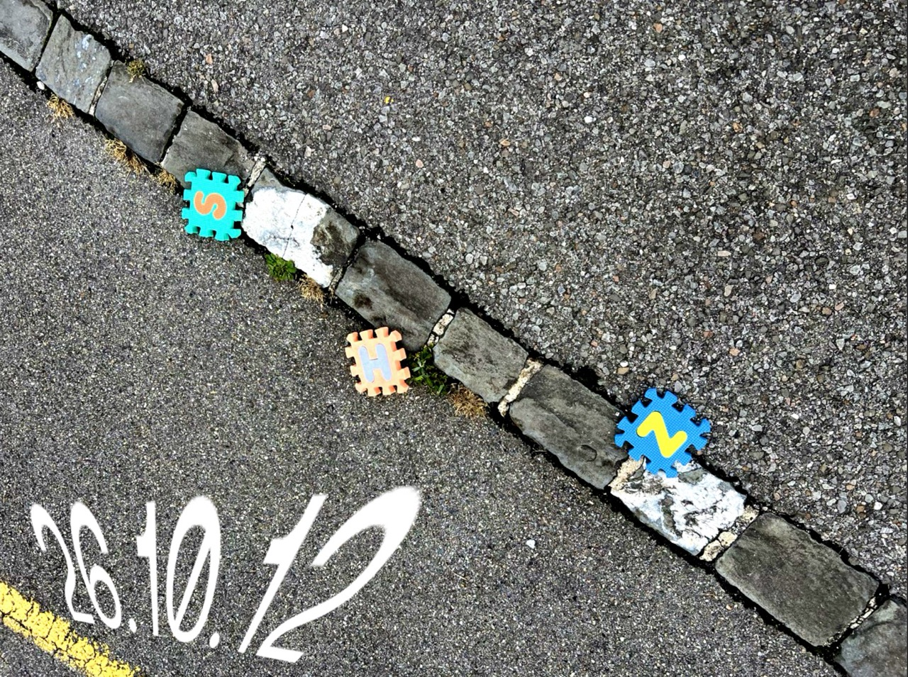

## <u>NARRATION</u>

→ faire connaître - racconter

Good storytelling takes us through the journey of transformation. 
[kishotenketsu](https://fr.wikipedia.org/wiki/Kish%C5%8Dtenketsu): 

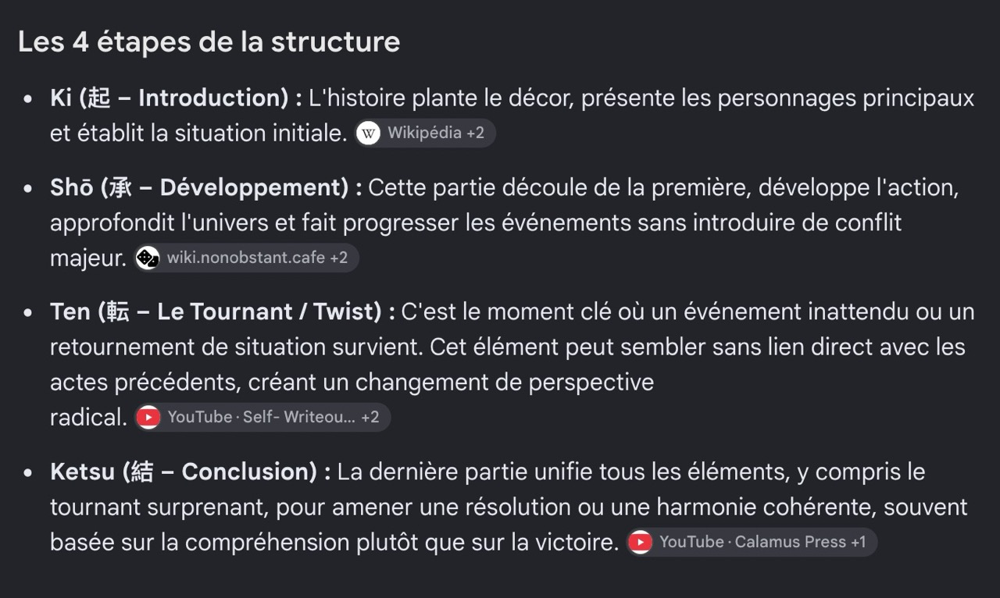
exemples: <u>Totoro !</u> 

WHO / WHAT / WHERE / WHEN / WHY / HOW ???

1. WORLD → Where / When
2. Personnage → Who / Why(?)
3. Intrigue / Plot → What / How

→ Typically, in the classic structure, one of these questions is deliberately left vague in order to develop the narrative around it (Why?).

(World - Persona - Plot)

## <u>Worldbuilding</u>

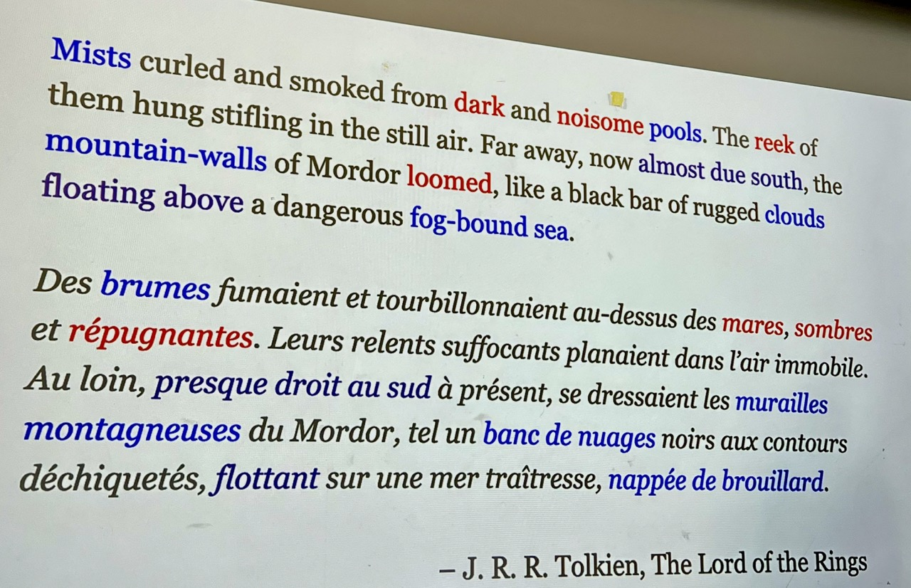

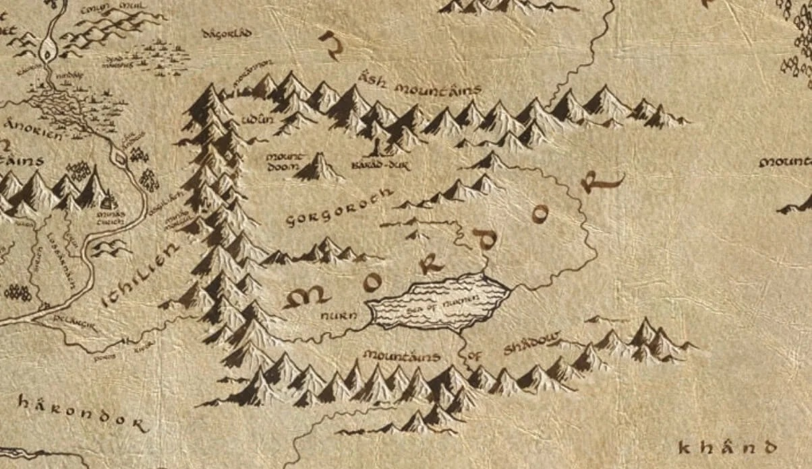

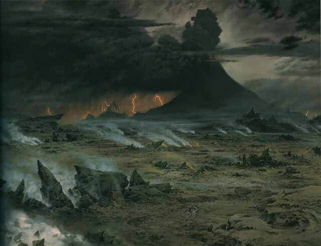

→ How a simple description leads to a multitude of complex representations. 
→ How to reduce a story or a world to its simplest form.
 
→ The reader contract → Provide as little as possible so that the reader builds the world with their imagination.

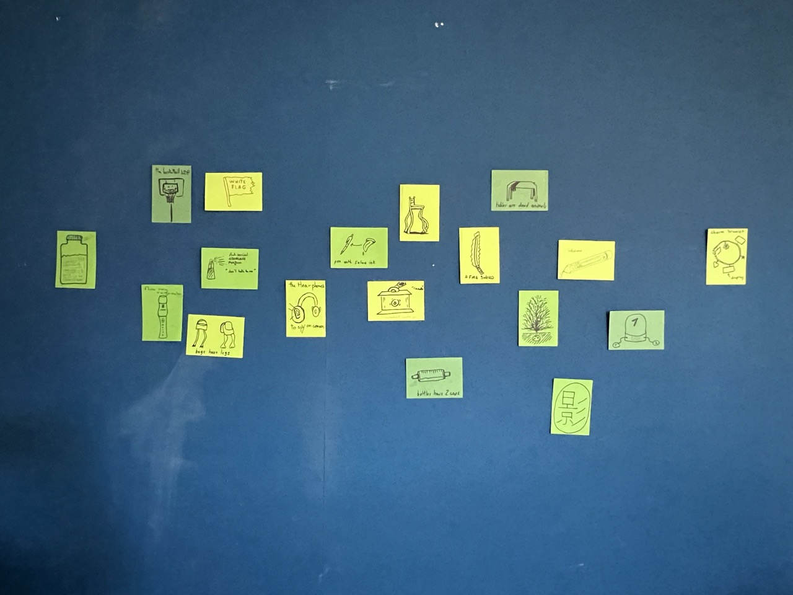

[exercice 1: Design a prop with: minimal departure / outlier / Novum /Synecdoche]

## <u>Persona - Character</u>

A character must have a clear intention. 
Obstacles, desires, needs, etc., make it possible to understand a character's intention. 

The character's behavior provides the information needed to understand them without the need for explanation. → show, don't tell !!! ( exemple: [Crankin's time travel adventure](https://play.date/games/crankin/) ) 

<u>→ All you have is a hammer - all looks like a nail !</u>

Watch out for tropes/clichés!!!
 **[→ Tropes vs women in video games](https://www.youtube.com/playlist?list=PLn4ob_5_ttEaA_vc8F3fjzE62esf9yP61)**

**In our context, the concept of internal conflict is central to harassment.**

[Achilles' heel — the very reason for its power is the source of its weakness.] 
<u> → Oxymore / A good character is contradictory. </u>
→ [excellent example](https://www.youtube.com/watch?v=1R42mFx3_ss)

STASIS vs CHANGE

<i>know thyself</i>

**restorative nostalgia vs reflective nostalgia**

## Exercice 2

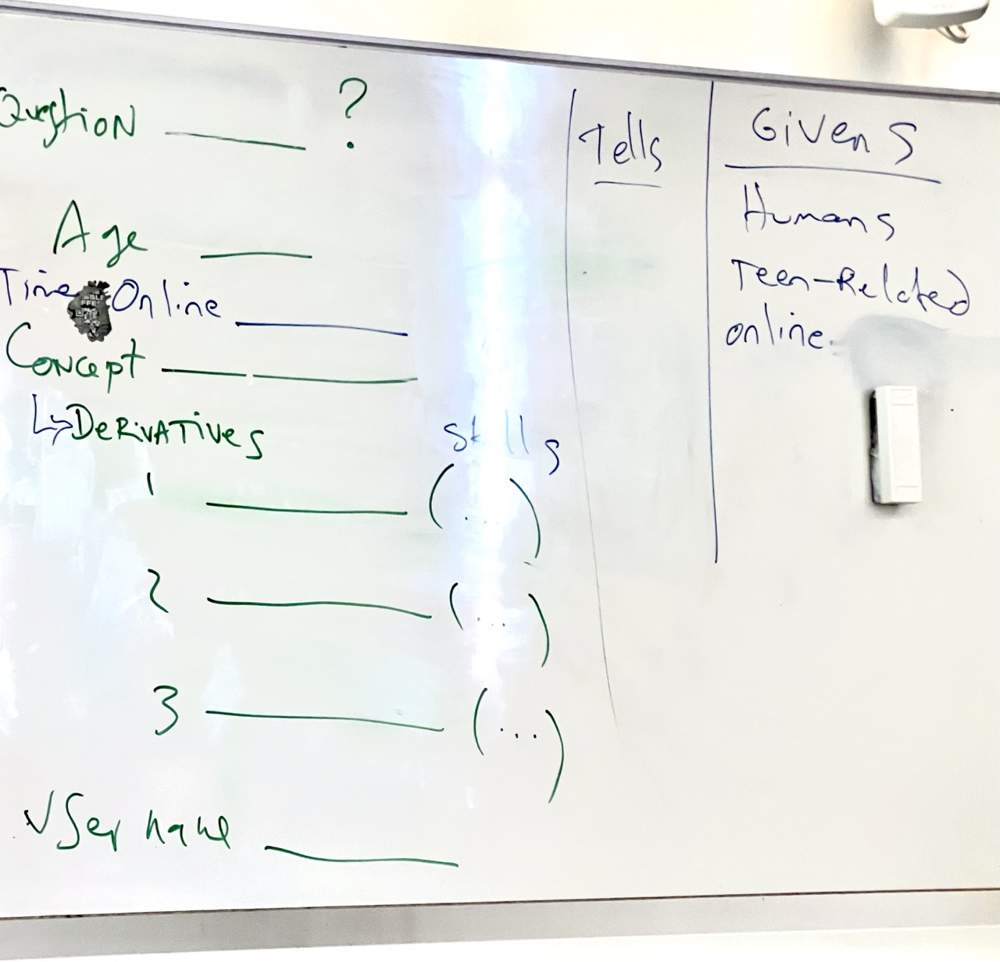
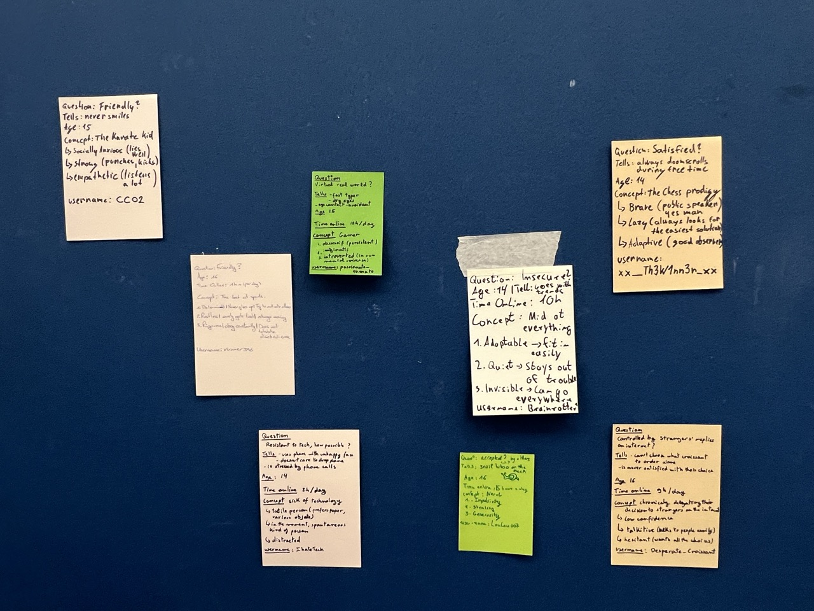
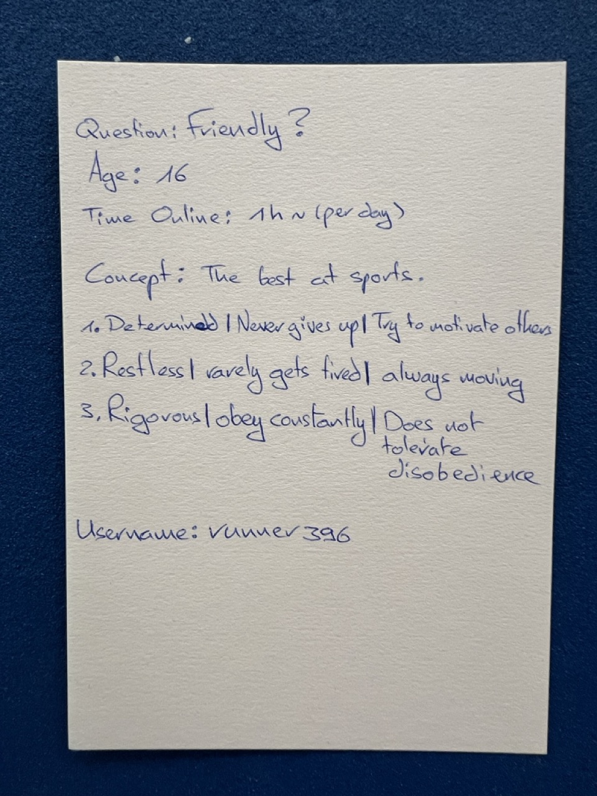

## Handwritten notes

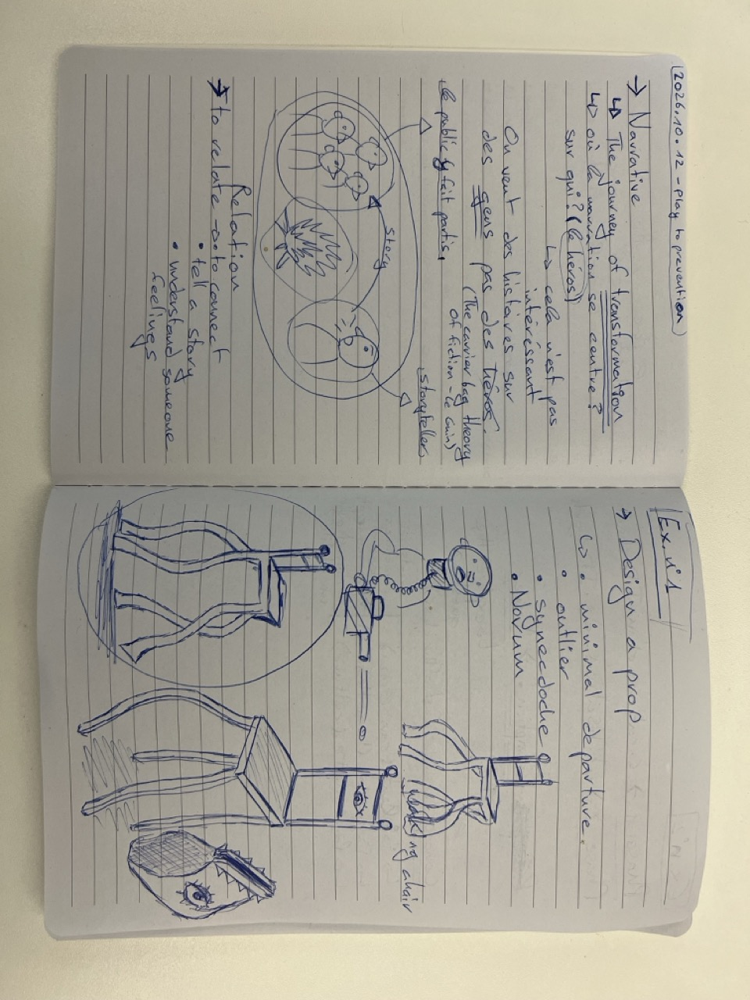
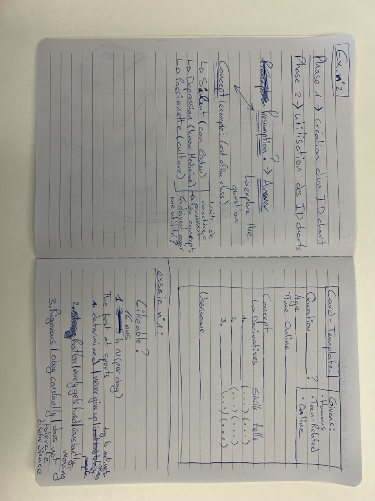

## REF:

- [Morphology of the folktale](https://monoskop.org/images/f/f3/Propp_Vladimir_Morphology_of_the_Folktale_2nd_ed.pdf)
- [The carrier bag theory of fiction](https://communityofwriters.org/wp-content/uploads/2024/01/The-Carrier-Bag-Theory-of-Fiction.pdf)
- [Possible worlds theory](https://en.wikipedia.org/wiki/Possible_world)
- [Possible Worlds, Artificial Intelligence, and Narrative Theory](https://luisnavarrete.com/USC/pdf/Marie_Laure_Ryan.pdf)
- [Six Walks in the Fictional Woods](https://en.wikipedia.org/wiki/Six_Walks_in_the_Fictional_Woods)
- 

 

# 𖨠 26.10.06 - Virtual World - Worldbuilding 𖨠   (w/ Sabrina Calvo & Douglas Edric Stanley) 

 

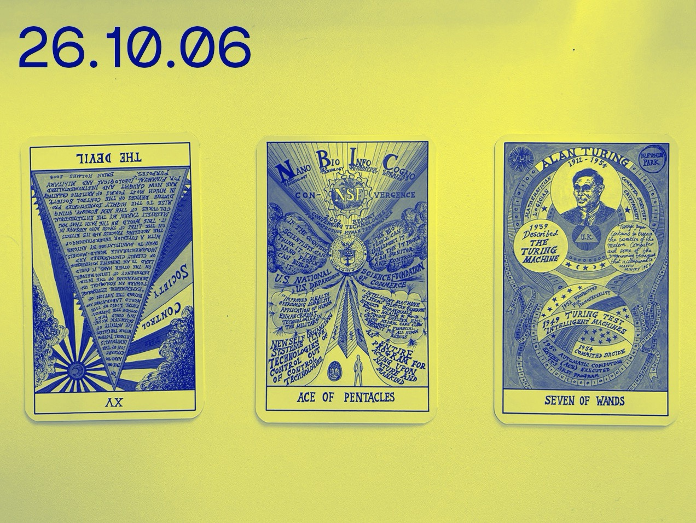

The virtual world that we want to build to target a specific market.  
- How do we bring teenager to our project ? 
- Are there any narrative dissonances ?
- Can the game system give rise to a form of "emergent harassment" ?

## Exercise

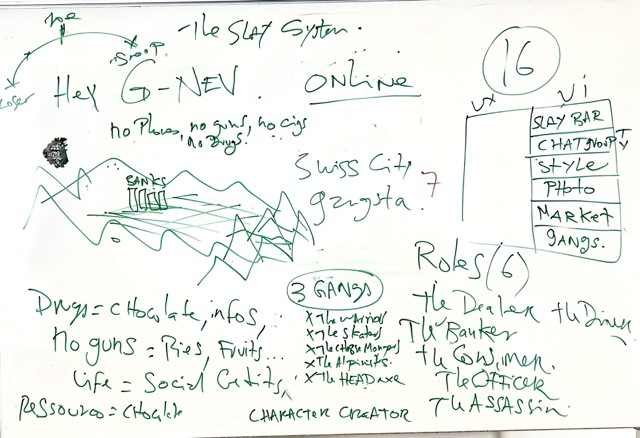
→ This is an example of world building that demand features  
(that can ultimately create "emerging harassment").

<u>Let's imagine a scenario in which gameplay mechanics can generate a situation of harassment:</u>

The slay system is, in this case, central to the functioning of the game.

“Slay points” are independent of the social class of the character being played and depend entirely on the economy governing the game. The more “money” a player has, the more slay points they accumulate.

As a result, harassers could, for example, mock players who have less money and therefore fewer slay points. Perhaps this money could be easily obtained through a pay-to-win system, causing harassers to bring the victim’s real-life economic situation into the virtual world.

By extension, a harasser could draw a parallel between the victim’s personal life and their in-game character, as well as the number of “slay points” they have.

Although using a public discussion channel can be risky for a harasser, as they may be excluded or banned from it, they could nevertheless use it to spread false rumors about the victim, potentially causing the victim to be excluded from or even banned from the server.

Similarly, one-to-one communication channels provide the harasser with a direct point of contact with the victim, allowing them to discriminate against, insult, or otherwise harass them.

The multiplayer aspect of the game can also create additional problems. It requires players to create an account, which can potentially be tracked by one or more harassers across different servers. Over time, this could ultimately prevent the victim from being able to play the game altogether.

## REF:

- [Toon Town - Emotions system](https://toontown.fandom.com/wiki/Emotions) 

 

# 𖨠 26.10.05 - Cyberpunk - Worldbuilding 𖨠   (w/ Sabrina Calvo & Douglas Edric Stanley) 

 

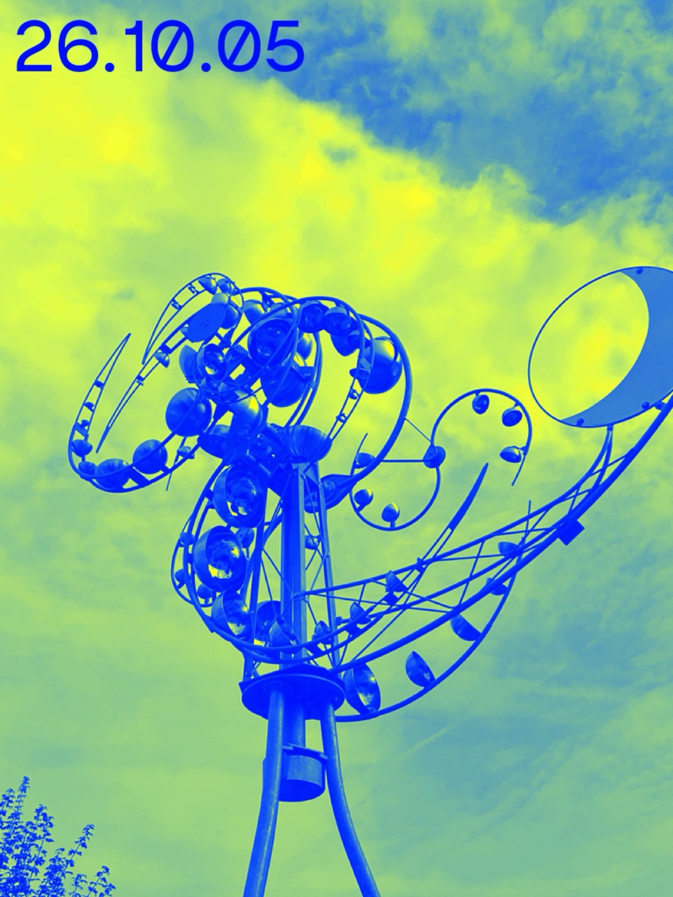

**Cyberpunk is not about aesthetic !**  
Documentation of the marginals of the cyber society. 

Cyber → An absolute objective point of view 

Maya → Illusion 

**Style is substance !** 
Cyberpunk became an aesthetic trend. The political aspect has disappeared or been recycled (again and again). 

**Post Cyberpounk:**  
What if we can make things better ? What after the shock ?  
<u>Things **can** look better once we went trough the trauma.</u>

## Handwritten notes

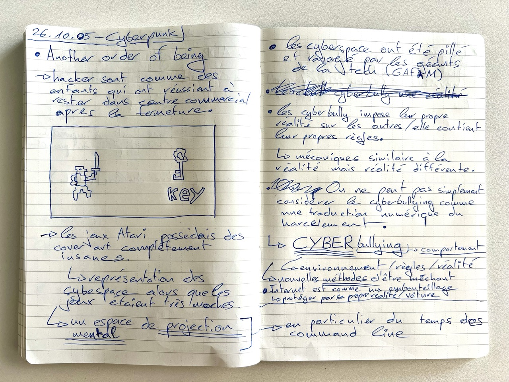
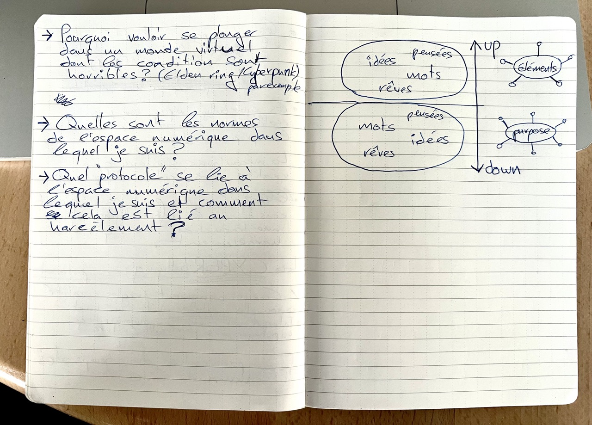

## REF:

- [The Cybernetic Hypothesis](https://theanarchistlibrary.org/library/tiqqun-the-cybernetic-hypothesis)
- [Bruce Bethke / Cyberpunk](https://en.wikipedia.org/wiki/Cyberpunk_(short_story))
- [William Gibson / Neuromancien](https://fr.wikipedia.org/wiki/Neuromancien)
- [Burning Chrome](https://fr.wikipedia.org/wiki/Grav%C3%A9_sur_chrome_(nouvelle))
- [Philip K. Dick](https://fr.wikipedia.org/wiki/Philip_K._Dick)
- [Naked Lunch](https://en.wikipedia.org/wiki/Naked_Lunch)
- [Do Androids Dream of Electric Sheep?)](https://fr.wikipedia.org/wiki/Les_andro%C3%AFdes_r%C3%AAvent-ils_de_moutons_%C3%A9lectriques_%3F)
- [Critical Web Design](https://owenmundy.com/site/critical-web-design)
